

  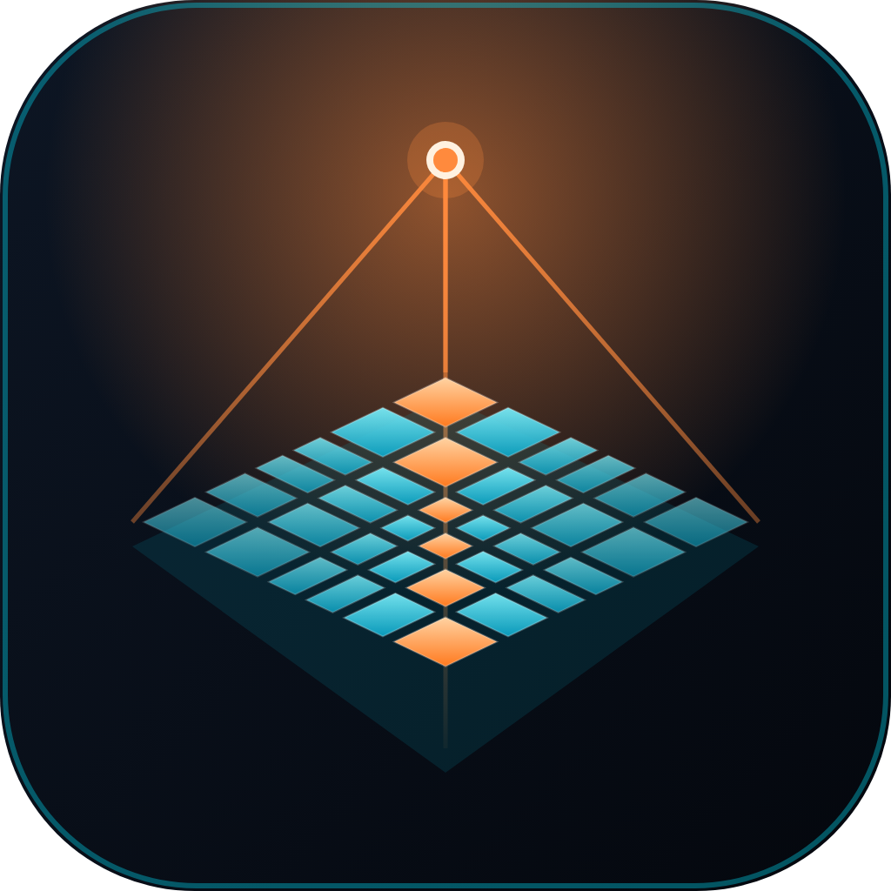

<h1 align="center">Tessera Projection</h1>

  <b>Collision, Boolean and quad-remesh projection for any mesh in Blender.</b> 
  A Level Of Tessellation system that lets 3D assets project themselves, so they can collide, cut, flow and remesh without manual setup.

  
  
  
  

---

## What it does

Tessera Projection is built around one idea: **a mesh can be projected against itself and against its neighbours**. That projection (called **LOTBCBP**, *Level Of Tessellation Boolean Collision Body Projection*) gives each asset a collision body whose resolution follows the geometry, finds where cavities connect, and measures its own surface, and the same math drives three tools.

| Tool | What it gives you |
|---|---|
| **Projection Remesh** | A fast quad remesh. Dense, symmetric quads along creases, lips, wrinkles and ears; large quads on broad surfaces. Works on characters, cars, trees, CAD, and scans, at any position or rotation. |
| **Boolean Projection** | Cavities that intersect become one continuous through-cavity, with optional Boolean joint cuts in the walls. |
| **Arc Flow** | Self-initialising fluid and combustion simulation through those connected cavities: containers, pipes, chambers and nozzles that start empty and only conduct, finite fills, leaks, plugs, thermal and stress colouring. |

  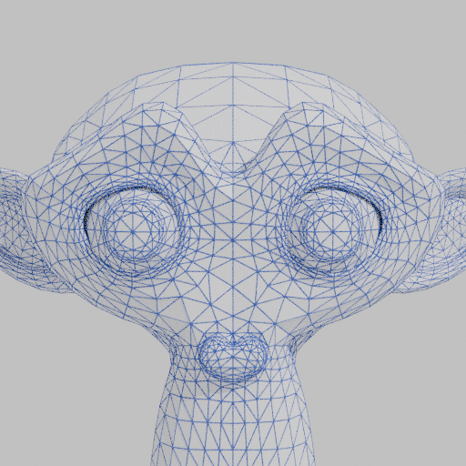
  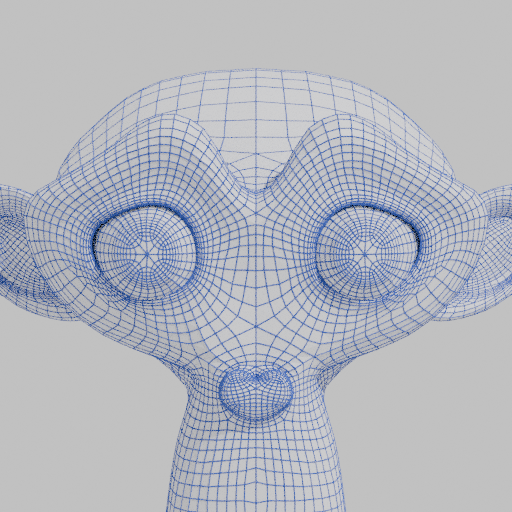

<i>Projection Remesh: triangulated input (left), symmetric quads with crease-driven density (right).</i>

## Projection Remesh

- **The mesh is its own reference.** Every new vertex is projected back onto the original surface, and the result is measured against it.
- **Density from the surface itself.** Crease angle, small features and the Arc Edge curvature scale set the target size per region. No face selection in Edit Mode.
- **Symmetrize.** With a confident mirror plane the quads are made truly symmetric: pick the side to trust (Auto, Left, Right, Average) and a strength; the report gives asymmetry before/after and the deviation from your source.
- **Symmetry without setup.** The mirror plane is detected from the mesh, wherever the object sits and however it is rotated. Near-symmetric meshes (sculpts, triangulations that do not line up across the sides) are made symmetric; asymmetric regions are left alone and reported.
- **Resolution multiplier, 0.01 to 12.** 1.0 is a one-to-one remesh; below 1.0 decimates, above 1.0 adds resolution. Run it again for more.
- **Keeps your data.** UV maps (including UDIM tiles), colour attributes, vertex groups, materials and generic attributes are transferred; choose to keep the old UVs, add a fresh set, or skip.
- **Modifier-safe.** It is an operator, not a modifier. Read the evaluated mesh with any modifier order, or the base mesh. The original and its stack are never touched.
- **Recalculate Normals (Outside)**, before, after, or on its own.
- **Large meshes.** An automatic fast path above 200,000 faces, with progress and Esc to cancel.

Measured on Blender 5.3.0 (shared 2-core machine, so timings are rough):

| Input faces | Output faces | Quad ratio | Time |
|---|---|---|---|
| 98,280 | 49,615 | 98% | 1.4 s |
| 991,018 | 497,076 | 99% | 13.6 s |
| 3,972,048 | 1,989,188 | 99.7% | 83.7 s |

The fast path pairs triangles into quads, so it keeps the source triangulation's symmetry; see the [technical reference](docs/TECHNICAL.md) for what is exact, what is approximate and the limits.

## Arc Flow: systems that initialise themselves

  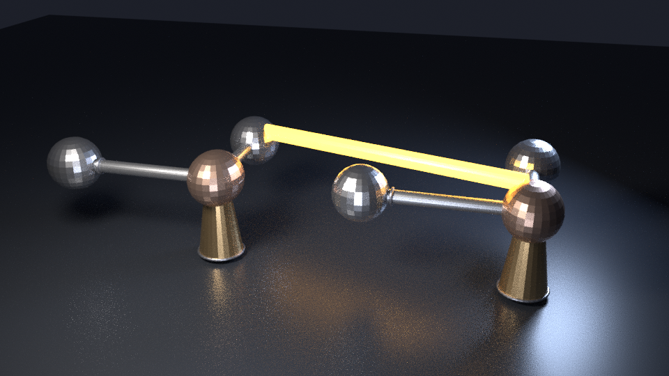

  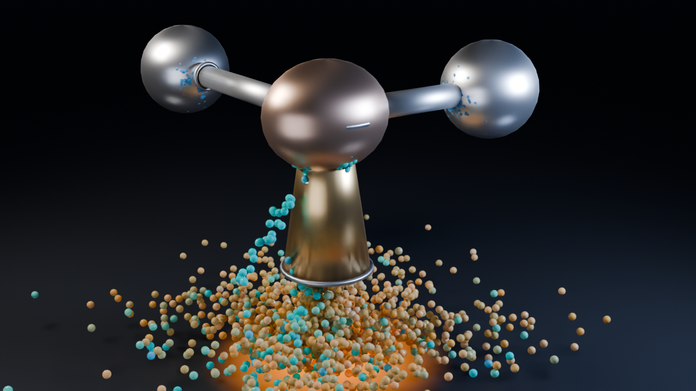
  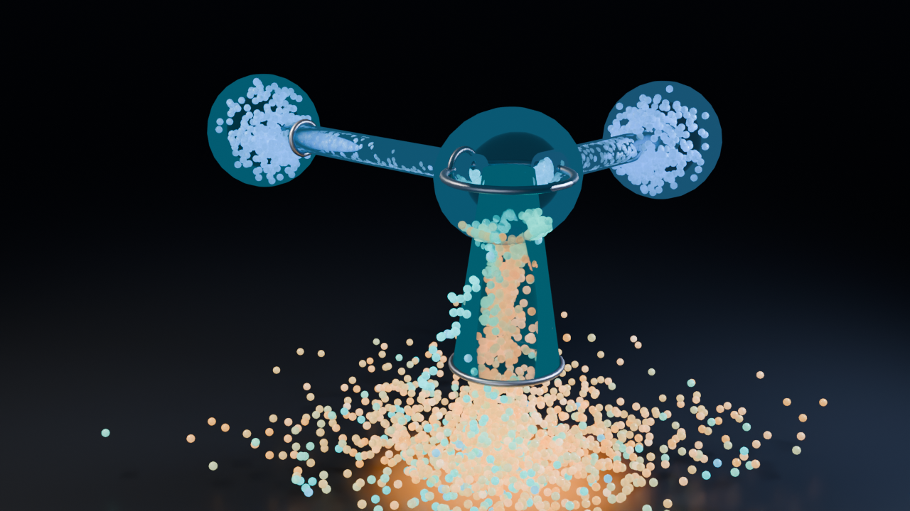

- Parts are grouped into independent **systems**; roles (container, transport, chamber) and requirements are detected automatically and re-detected when parts move or connect.
- **Demos built from Blender's default primitives:** a single engine and twin engines with a crossfeed pipe, with a Good and a Bad variant that end in enhanced combustion or a wall rupture.
- **Environment card:** Earth, Mars, Venus, Titan and Jupiter atmospheres with editable gas mixes, driving ambient pressure, drag and plume spread.
- Points, Ray-march and Gaussian render paths (Cycles verified), with Geometry Nodes groups for every card.

The simulation is a simplified, documented model, not a full Navier-Stokes solve everywhere.

## Fluid mode: volumetric, particle-based fluid dynamics

  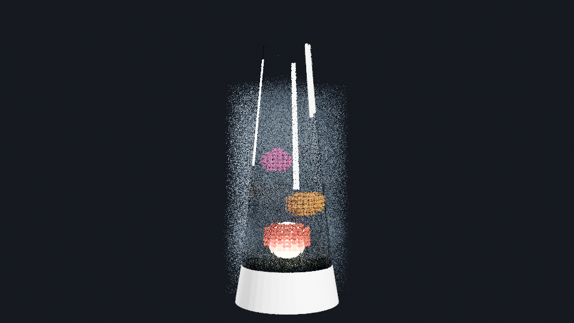
  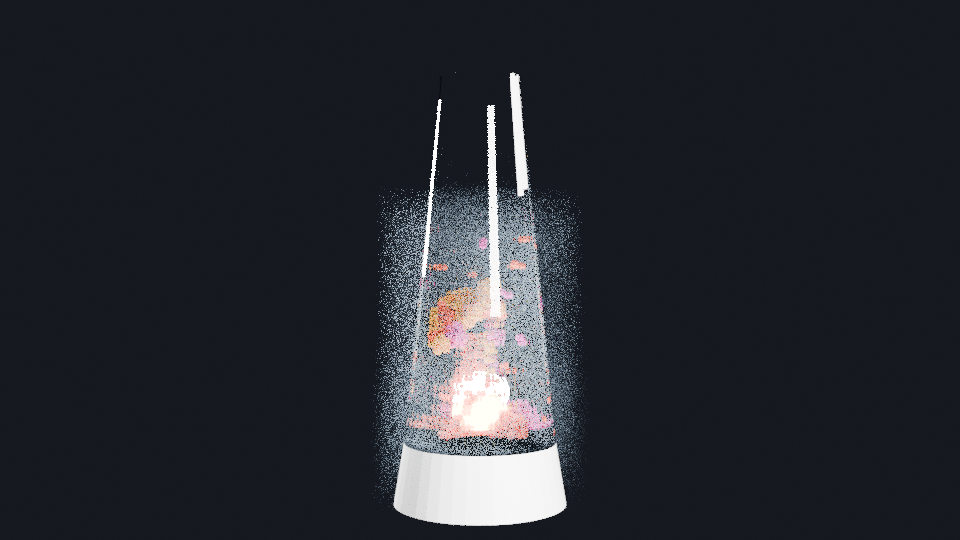

  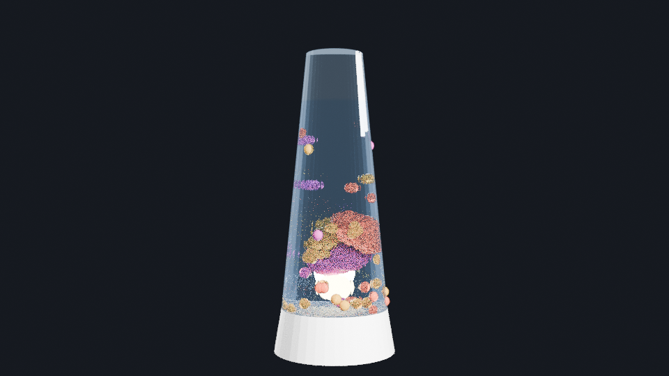

  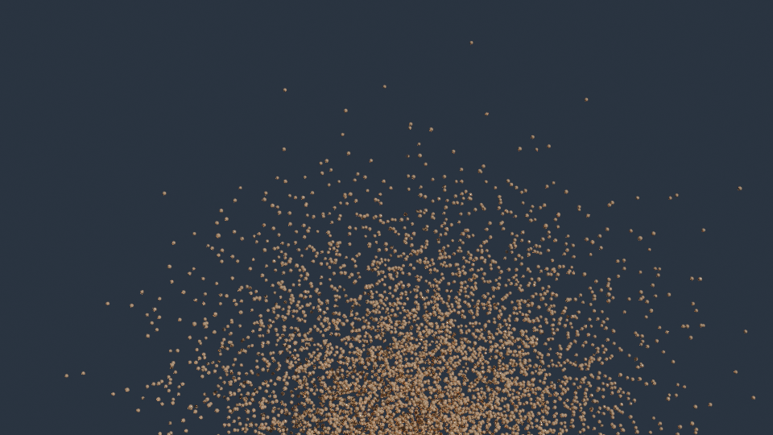
  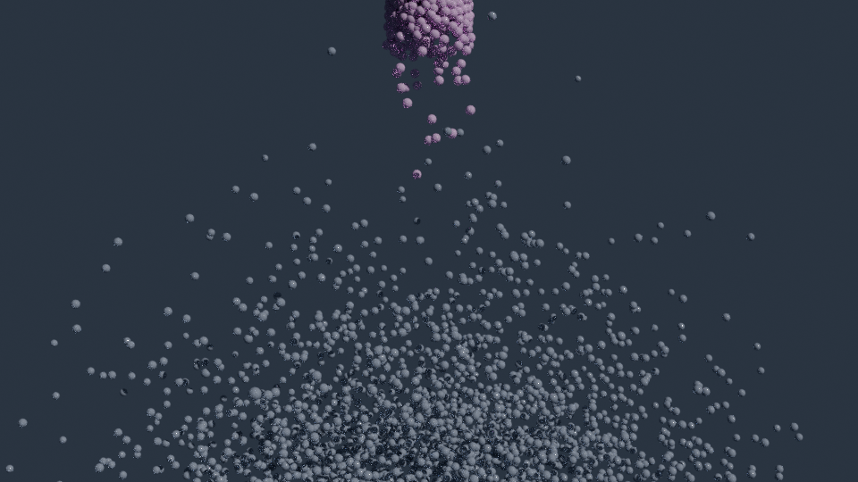

  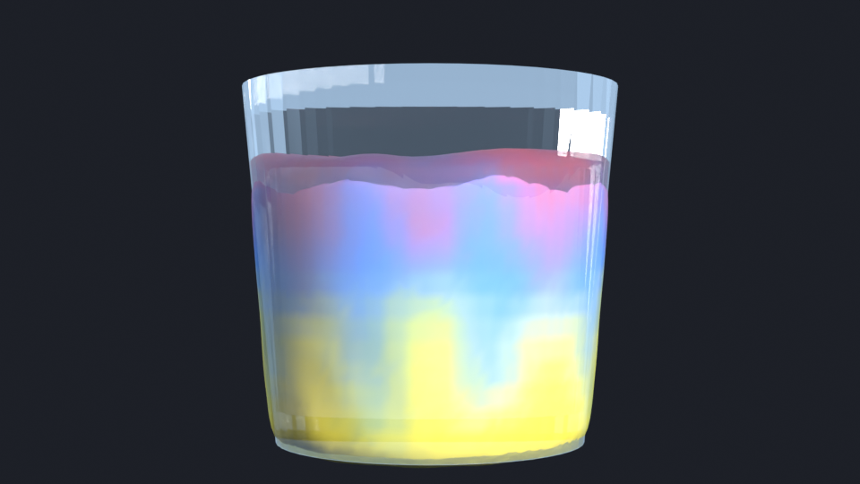
  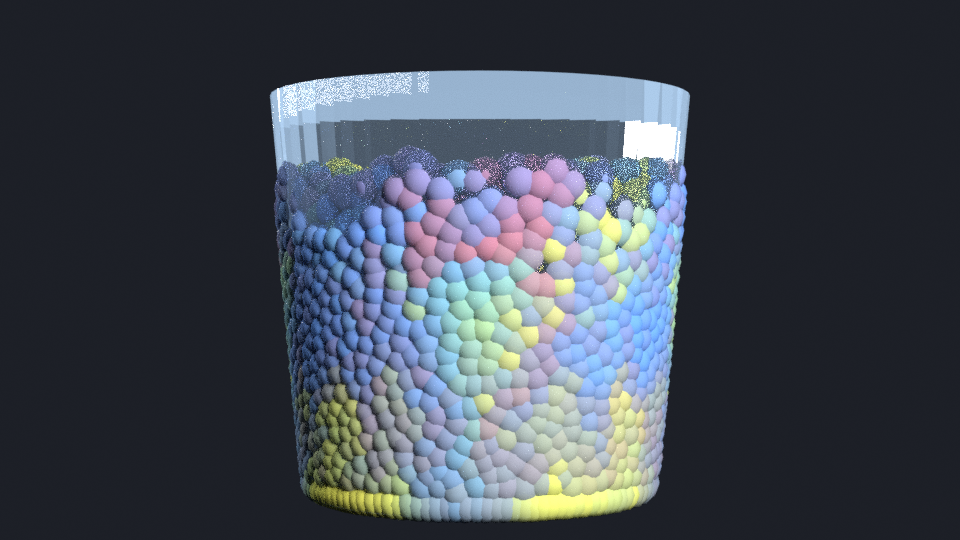
  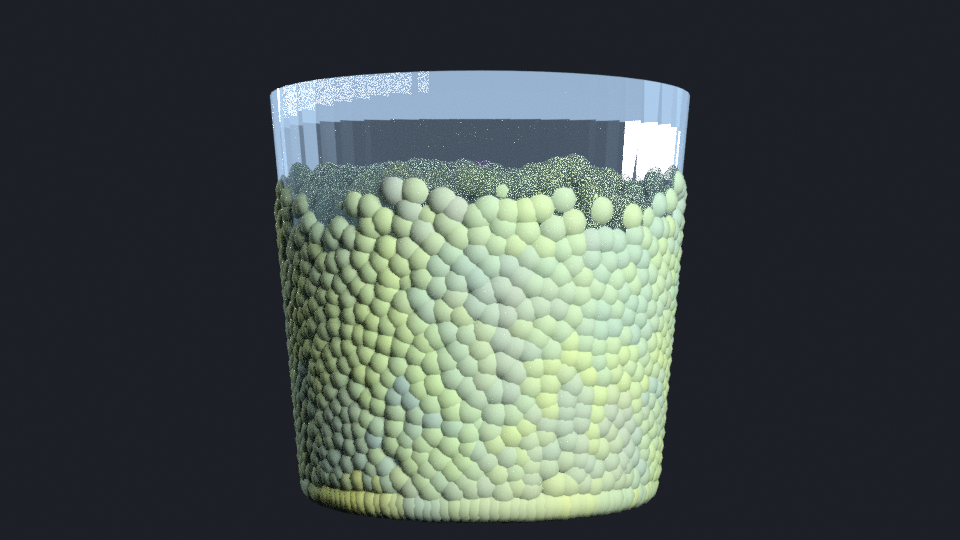

**Merging and mixing (0.4.0).** Particles carry a composition (species mass fractions). Miscible fluids exchange composition and heat by Fick diffusion (mass and enthalpy conserved), the colour is the subtractive (weighted geometric) mix, density, expansion and heat capacity follow the composition. Optional per-species priority lets a dominant fluid absorb a minority (one cluster, one colour), and a JSON reaction table (temperature, relative-velocity, density-ratio and concentration windows, heat in J/kg) transforms species. Render mode **Surface** welds blobs into one coloured mesh (two touching blobs give one surface, apart give two). Demo: *Colour Mixing*.

Switch the panel from Combustion to **Fluid** and turn any mesh into a self-initialising fluid (mass, volume, density, temperature, velocity, viscosity and more, with missing values derived). Fluids with or without a container, mixing, thermal convection (lava lamp), free gas rising or sinking in the Environment (gravity, barometric pressure, ambient density, wind, ground), moving containers and colliders, and Geometry Nodes groups per fluid.

Assigned to a container (the lava lamp's glass cone), a fluid takes the cavity's real contoured shape: the quantity is poured in under the Environment gravity, settles into layers (densest at the bottom), and that settled state is the start frame; the lamp then heats and the blobs move. `Fill / Settle` and `Quick fill` are in the panel.

It solves liquids with FLIP/PIC and a variable-density pressure projection, and gases as buoyant Lagrangian parcels. Solid to fluid is exact; fluid to solid is one-way, and gas does not interact with liquid. Measured: 0.24 s per frame at 5,162 particles and 0.75 s at 18,900 (NumPy, 2 shared cores). Details and limits: [technical reference](docs/TECHNICAL.md#fluid-mode-volumetric-particle-based-lagrangian-fluid-dynamics).

## Install

1. Download `tessera_projection-0.2.0.zip` (from extensions.blender.org or this repo's Releases).
2. In Blender: **Edit > Preferences > Get Extensions > (v) > Install from Disk**, pick the zip.
3. Open the 3D Viewport sidebar (**N**), tab **Tessera**.

From source: `./build.sh` validates and builds the zip into `dist/`.

## Quick start

- **Remesh:** select a mesh, open *Tessera > Projection Remesh*, press **Analyse Topology** to see triangles and odd faces, then **Projection Remesh**.
- **Fluids:** *Tessera > Tessera Projection > Add Demo Rig*, then **Build**. Try **Load Demo: Twin Engines + Crossfeed**.

## Status and roadmap

Version 0.3.0 is tested headless on Blender 5.2.3 LTS and 5.3.0. Interactive UI testing and an EEVEE render check are still to do.

Coming next: two-way fluid-solid coupling, curvature-aligned quad layout, exact symmetry in the large-mesh path, shape-key transfer. See [docs/ROADMAP.md](docs/ROADMAP.md) and the [changelog](CHANGELOG.md).

## Documentation

- [Technical reference](docs/TECHNICAL.md): methods, benchmarks, limits, tests
- [Publishing notes](PUBLISHING.md)

## Support and contributing

Bugs and questions: [open an issue](https://github.com/DART-Skyboard/tessera-projection/issues) with your Blender version, the tool you used and, if you can, a small .blend. Pull requests are welcome.

## Credits and license

Created by Justin Craig Venable, Radical Deepscale LLC (DART Meadow). The Arc Edge measuring math is from the LEATR / Arc Edge documentation. Licensed under **GPL-3.0-or-later**; see [LICENSE](LICENSE).
